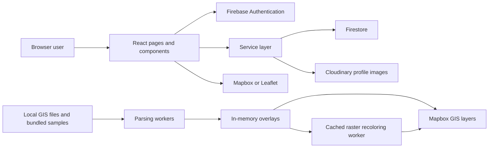

# IT Unit Management System

**People, places, GIS data, and documents in one React workspace.**

A practice application for managing a staff directory, saved locations, custom lists, and rich-text documents. Its GIS explorer combines shapefile attributes and GeoTIFF raster previews on a Mapbox map, with editable colors and visibility.

**Stack:** React 19 · Vite 8 · Firebase · Mapbox GL JS · Leaflet · Quill

> This README covers `React/it-unit-react`. The older AngularJS application in `Practice01` is a separate project. This is a practice system, not a claim of production readiness or complete desktop-GIS functionality.

[Get started](#quick-start) · [Explore features](#features) · [GIS guide](#gis-explorer) · [Troubleshooting](#troubleshooting)

## Contents

- [Features](#features)
- [Quick start](#quick-start)
- [Configuration](#configuration)
- [GIS explorer](#gis-explorer)
- [Data and persistence](#data-and-persistence)
- [Architecture](#architecture)
- [Project structure](#project-structure)
- [Development and verification](#development-and-verification)
- [Deployment](#deployment)
- [Current limitations](#current-limitations)
- [Troubleshooting](#troubleshooting)
- [Possible future improvements](#possible-future-improvements)
- [Assets and acknowledgments](#assets-and-acknowledgments)

## Features

| Module | Route | Capabilities |
| --- | --- | --- |
| Login | `/login` | Firebase email/password sign-in, circular purple glass-style form, animated aurora background and pointer highlight |
| Staff Directory | `/` | Add, edit, activate/deactivate, search and delete staff; profile photos; spreadsheet import; Excel, CSV and PDF export |
| Location Map | `/map` | Mapbox/Leaflet switching, saved markers, location search, coordinate picking, add/edit/delete locations |
| GIS Explorer | Within `/map` | Shapefile ZIP upload, attributes, DN groups, category colors and visibility; GeoTIFF upload, raster colors and opacity |
| General Lists | `/general-lists` | Custom tables with text, number, date and boolean columns; record editing, search and pagination |
| Document Editor | `/document-editor` | Rich text, manual save, autosave, paper settings, paginated preview, word and character counts |

All workspace routes require sign-in. Staff Directory, Location Map, General Lists, and Document Editor include Driver.js guided tours. Layouts adapt to smaller screens, and the explorer opens from a compact layers icon.

<details>
<summary><strong>Staff Directory workflow</strong></summary>

Create a staff record with a name, role and optional photo. New records begin as Inactive; activate them when needed. Profile images upload to Cloudinary, while record details and image references are stored in Firestore.

Import Excel or CSV data with **Full Name** and **Role** headers on the same row. Imported records also begin as Inactive. Export tools provide Excel, CSV and PDF output. Use disposable records when practicing imports or deletion.

</details>

<details>
<summary><strong>General Lists workflow</strong></summary>

Create a list, define its columns, then add records using the generated form. Switch between lists, edit their structure, and search or paginate their rows. The selected list is remembered in the browser. Each list stores its columns and records together in one Firestore document.

</details>

<details>
<summary><strong>Document Editor workflow</strong></summary>

Format text with headings, lists, colors, alignment, bold, italic and underline. Use Save or allow autosave to run after 10 seconds of inactivity. During continuous editing, the saver schedules a save after at most 60 seconds and retries failed autosaves up to three times. Saves update the same document ID within the current editing session.

Switch to Preview to inspect pagination. Choose paper size, orientation and margins; custom dimensions are supported. The preview displays up to 100 pages. New starts a fresh editing session and attempts to save pending content first. Check the save status before leaving; network-dependent writes are not a guarantee of recovery after a browser closes.

There is currently no saved-document browser or reopen action. Saving to Firestore does not automatically restore that document after reloading.

</details>

## Quick start

### 1. Prepare the environment

Use **Node.js 24.x** and npm for this project. The installed toolchain was inspected with Node 24; older Node versions may not meet dependency engine requirements. Use a modern browser with WebGL support for Mapbox.

From the repository root:

```powershell
cd React/it-unit-react
npm ci
```

`npm ci` installs the versions in `package-lock.json`. Use `npm install` when intentionally changing dependencies and commit the resulting lockfile changes.

### 2. Configure services

Copy the provided template **only if you do not already have a `.env` file**:

```powershell
Copy-Item .env.example .env
```

Fill in your own values using the [configuration reference](#configuration). In your Firebase project, enable Email/Password authentication, create a test account, and provision Firestore with rules appropriate to your test users. There is no public registration form in the app.

### 3. Run the app

```powershell
npm run dev
```

Open the local URL printed by Vite, sign in, and use the sidebar to navigate. Firebase-backed features and online map tiles require network access.

### 4. Try the GIS sample

Open **Location Map → Mapbox → layers icon → Raster → Load Agathis sample**. The bundled amphibians vector layer loads automatically when the map page opens. Hide its DN groups if they obscure the raster beneath it.

## Configuration

The app reads these variables from `.env` at build/dev-server startup. Restart the dev server after changing them; deployed builds must be rebuilt.

| Variable | Purpose |
| --- | --- |
| `VITE_FIREBASE_API_KEY` | Firebase web-app configuration |
| `VITE_FIREBASE_AUTH_DOMAIN` | Authentication domain |
| `VITE_FIREBASE_PROJECT_ID` | Firestore/Firebase project |
| `VITE_FIREBASE_STORAGE_BUCKET` | Firebase configuration field; current GIS uploads do not use Firebase Storage |
| `VITE_FIREBASE_MESSAGING_SENDER_ID` | Firebase web-app configuration |
| `VITE_FIREBASE_APP_ID` | Firebase web-app identifier |
| `VITE_MAPBOX_ACCESS_TOKEN` | Public Mapbox access token for the Mapbox view |
| `VITE_CLOUDINARY_CLOUD_NAME` | Cloudinary account used for profile images |
| `VITE_CLOUDINARY_UPLOAD_PRESET` | Unsigned upload preset used for profile images |

Firebase configuration is needed for sign-in and saved records. Mapbox settings are needed for Mapbox and GIS visualization; Cloudinary settings are needed when uploading profile photos.

All `VITE_` values are included in client-side code. They are not a place for service-account credentials, private API keys or Cloudinary API secrets. The local `.env` is ignored by Git; the example contains placeholders only.

Route protection controls navigation, while Firestore rules control database access. The current services access shared collections without owner filtering; they do not implement role-based permissions or per-user data isolation. No deployed Firestore rules are supplied or verified by this repository.

## GIS explorer

The layers icon opens a dialog with **Vector**, **Attributes**, and **Raster** tabs. Escape closes the dialog; arrow keys switch between its tabs. On small screens, the dialog uses the available viewport and scrolls internally.

### Vector: shapefile ZIP

1. Select Mapbox and open **GIS explorer → Vector**.
2. Choose **Upload ZIP** or **Replace ZIP**.
3. Include matching `.shp`, `.shx`, `.dbf`, and `.prj` files; include `.cpg` when available.
4. Inspect values in **Attributes** and choose the field used for styling in **Vector**.
5. Set colors or uncheck categories to show only the features you need.

Supported geometries include points, lines, polygons and their multi-part equivalents. Multiple datasets inside one ZIP combine into one overlay; uploading another ZIP replaces that overlay rather than adding a separate layer. Without `.prj`, coordinates must already be WGS84 longitude/latitude.

The **DN** field defaults to ranges of ten, such as 0–9, 10–19 and 20–29. Individual-value styling is also available. Each category has a color and visibility control. Hiding categories changes the map, not the attribute records. Color and visibility changes preserve the map position.

**Bundled default:** `public/shapefiles/amphibians-priority1.zip`, containing 4,742 polygons. It loads on each map-page visit. Remove overlay hides it for that visit; Load default restores it.

### Raster: GeoTIFF

1. Open **GIS explorer → Raster**.
2. Upload a `.tif`/`.tiff`, or select **Load Agathis sample**.
3. Adjust visibility and opacity.
4. Choose Low, Lower middle, Upper middle and High colors, then **Apply colors**.
5. Use **Reset colors** to restore the default scale.

| Stop | Default color | Position in preview value range |
| --- | --- | --- |
| Low | Blue `#2563eb` | 0% |
| Lower middle | Green `#16a34a` | 33.33% |
| Upper middle | Yellow `#facc15` | 66.67% |
| High | Red `#dc2626` | 100% |

Colors blend smoothly between the four stops. The legend reflects applied colors; picker edits remain pending until Apply. A higher value means higher priority only when that interpretation is valid for the source dataset.

The reader displays the **first numeric band**, makes NoData/nonfinite pixels transparent, and derives the legend from valid preview values. It supports north-up, pixel-area rasters in **EPSG:4326** or **EPSG:3857**. Other coordinate systems, rotations and point-sampled grids require conversion before upload.

**Bundled sample:** `public/rasters/Agathis_sp_GEE.tif`, 529 × 620 pixels, one band, EPSG:4326, NoData `-9999`. It remains available with the app but loads only when requested. One raster can be displayed alongside the vector overlay.

### Preview limits and performance

| Limit | Shapefile | Raster |
| --- | --- | --- |
| Input size | 20 MB ZIP | 20 MB TIFF |
| Source complexity | 50,000 features; 500,000 coordinates | 8 million pixels; 16 bands |
| Additional raster bound | — | 128 MB estimated decoded sample data |
| Preview resolution | Original accepted geometry | Up to 1,024 pixels per side |
| Processing timeout | 30 seconds | 60 seconds for loading; 30 seconds for recoloring |

Parsing runs in workers. Raster recoloring uses cached, projected preview values and a separate worker, so it does not reread the TIFF or recreate the map. The normalized raster cache uses at most 4 MiB; decoding, image generation, GPU textures and other app data require additional memory.

Overlay rendering is currently **Mapbox-only**. Switching to Leaflet retains the current overlay state but hides it until Mapbox is selected again.

## Data and persistence

| Data | Stored where | Behavior |
| --- | --- | --- |
| User accounts | Firebase Authentication | Used for email/password sign-in |
| Staff | Firestore `staff` | Name, role, status, ID and profile-image references |
| Saved locations | Firestore `locations` | Name, coordinates, ID and creation/modification timestamps |
| General lists | Firestore `generalLists` | Name, columns and records array in each list document |
| Document content | Firestore `documents` | HTML content and timestamps; saved through the current editor session |
| Profile images | Cloudinary | Image URL/public ID referenced by staff records |
| Map provider/view, selected list, paper settings | Browser local storage | Device/browser preferences |
| Uploaded GIS files and styling | Page memory | Cleared when leaving/reloading the map page |
| Bundled GIS samples | `public/` files | Included in the website build |

GIS uploads are decoded locally; the current uploader does not send them to Firestore, Firebase Storage or a Mapbox tileset service. This does not make the base map offline: map styles and tiles still come from their providers.

Files bundled under `public/` are publicly downloadable when deployed, even though the application routes require login. Bundle only data intended for that access model.

## Architecture



The frontend talks directly to configured services; there is no custom backend server in this React project. Hooks manage subscriptions and state, service modules handle persistence, and GIS utilities isolate parsing and map updates. Markdown viewers without Mermaid support may display the diagram as code.

## Project structure

```text
it-unit-react/
├── .env.example              Configuration placeholders
├── package.json              Commands and dependency declarations
├── package-lock.json         Locked dependency versions
├── public/
│   ├── rasters/              Bundled Agathis TIFF
│   ├── shapefiles/           Bundled amphibians ZIP
│   └── videos/               Background videos and poster
├── src/
│   ├── App.jsx               Routes and authenticated workspace
│   ├── main.jsx              React and browser-router entry point
│   ├── components/           Map, editor, staff, list and layout components
│   ├── context/              Authentication provider
│   ├── firebase/             Firebase initialization
│   ├── hooks/                Data subscriptions and document saving
│   ├── pages/                Login and workspace screens
│   ├── services/             Firestore, image, import and export operations
│   ├── styles/               Theme and component styles
│   └── utils/                GIS readers, workers, styling and other helpers
└── tests/
    ├── fixtures/             Synthetic shapefile data
    ├── *.test.mjs            Node-based GIS tests
    ├── SHAPEFILE-TESTING.md   Vector acceptance checklist
    └── RASTER-TESTING.md      Raster acceptance checklist
```

Key implementation references:

- [Routes](src/App.jsx) and [Firebase configuration](src/firebase/config.js)
- [Map page](src/pages/MapPage.jsx) and [GIS explorer](src/components/map/ShapefileUpload.jsx)
- [Raster controls](src/components/map/RasterUpload.jsx) and [color interpolation](src/utils/rasterColors.js)
- [Shapefile validation](src/utils/shapefileData.js) and [GeoTIFF processing](src/utils/rasterData.js)
- [Document saving](src/services/documentSaver.js)

## Development and verification

Run these commands from `React/it-unit-react`:

| Command | Purpose |
| --- | --- |
| `npm run dev` | Start the Vite development server |
| `npm run lint` | Run ESLint |
| `node --test tests/*.test.mjs` | Run the GIS automated test suite |
| `npm run build` | Create the production bundle in `dist/` |
| `npm run preview` | Serve the built bundle locally for inspection |

There is no `npm test` script at present; use the Node command above.

The latest GIS implementation verification passed **19 tests**, lint and a production build. Tests cover actual sample parsing, validation, NoData, palette interpolation, DN grouping/visibility, and mocked map-layer lifecycle. They do not establish full application coverage or verify live Firebase, Cloudinary, authentication, mobile layout or actual Mapbox rendering.

Use the [shapefile checklist](tests/SHAPEFILE-TESTING.md) and [raster checklist](tests/RASTER-TESTING.md) for signed-in browser verification. The build currently reports a large-chunk warning; successful compilation does not imply optimized initial loading or production readiness.

## Deployment

1. Configure the deployment environment values before building.
2. Run lint, the GIS tests, and `npm run build`.
3. Publish `dist/` through a static hosting service.
4. Configure SPA fallback to `index.html` for application routes such as `/map` and `/document-editor`, while continuing to serve static files normally.
5. Configure the deployment domain in the relevant authentication and token settings, and verify database access with the intended test account.
6. Check login, saved records, both map providers, GIS samples and deep-link refreshes.

The current configuration assumes hosting at the domain root. Hosting under a subpath requires coordinated Vite base-path and router changes. The preview server is for local verification, not a production hosting service.

## Current limitations

- GIS uploads and styling are temporary; there is no backend GIS upload library.
- The map supports one combined vector overlay and one raster overlay, not an unlimited independently managed layer stack.
- Raster support excludes RGB composites, band selection, per-pixel inspection, raster attribute tables and arbitrary TIFF georeferencing.
- General-list records are stored together in an array and replaced on edits; this model needs redesign for large lists or robust concurrent editing.
- Staff, locations and lists use collection subscriptions; visible pagination does not mean server-side pagination.
- Document persistence exists, but reopening saved documents is not implemented.
- Authentication is present; application roles and ownership isolation are not.
- Service usage and hosting depend on the configured accounts. This README makes no pricing or free-tier guarantees.

## Troubleshooting

<details>
<summary><strong>The app will not start or reports an unsupported Node engine</strong></summary>

Check `node --version`, use Node 24.x, and run `npm ci` inside the React app folder. Review the first terminal error rather than reinstalling individual packages at random. Confirm `.env` exists and restart Vite after editing it.

</details>

<details>
<summary><strong>Sign-in or Firestore operations fail</strong></summary>

Confirm the Firebase configuration belongs to the intended project, the test account exists, and Email/Password sign-in is enabled. For permission errors, inspect the deployed Firestore rules and intended user access. A successful login alone does not grant database permissions.

</details>

<details>
<summary><strong>Mapbox is blank or a GIS layer is missing</strong></summary>

Check the public Mapbox token, network requests and browser WebGL support. Select Mapbox rather than Leaflet to view GIS overlays. In the explorer, verify category visibility, raster visibility and opacity. The vector layer sits above the raster, so hiding vector categories may reveal it. Sample files must be present under `public/` and reachable in the deployed build.

</details>

<details>
<summary><strong>A GIS file is rejected or looks misplaced</strong></summary>

Check the preview limits and file contents. Include matching shapefile projection metadata. For rasters, export a north-up, pixel-area GeoTIFF in EPSG:4326 or EPSG:3857. Simplify or reduce large datasets before uploading. Rectangular cells may be the actual source geometry; rendering cannot invent a more detailed boundary than the dataset contains.

</details>

<details>
<summary><strong>Raster color selections do not update immediately</strong></summary>

Choose all four colors and click Apply colors. The legend shows the palette currently applied to the map, not uncommitted picker changes. Reset colors restores blue → green → yellow → red. Reloading a dataset restores defaults.

</details>

<details>
<summary><strong>Profile uploads fail or a deployed route returns 404</strong></summary>

For images, check the Cloudinary cloud name and unsigned upload preset. For route refreshes, check the host's SPA fallback. Missing assets require checking their URLs and deployed files, not rewriting asset requests to HTML.

</details>

## Possible future improvements

These are ideas, not implemented features or delivery commitments:

- A persistent GIS dataset library with server-side validation and tiled delivery.
- Independent multi-layer management and saved styles.
- Raster band selection, pixel-value inspection and additional projections.
- A saved-document browser and reopen workflow.
- Role-based access, data ownership, server-side pagination and concurrency handling.
- Broader automated browser tests and smaller initial application bundles.

## Assets and acknowledgments

The application uses React, Vite, Firebase, Mapbox GL JS, Leaflet, Quill, Driver.js, shpjs, GeoTIFF.js, SheetJS, jsPDF, SweetAlert2, Lucide and Fontsource packages. See `package.json` and `package-lock.json` for dependencies and versions.

Map attribution belongs to the relevant map providers and OpenStreetMap contributors. Inter and Plus Jakarta Sans are supplied through Fontsource. The existing background asset is identified as Purple Desert from GetLayers; confirm its applicable terms before redistribution. The user-supplied GIS samples should retain their source provenance and redistribution permissions. No licensing claim for those datasets is established by this README.

[Back to top](#it-unit-management-system)
